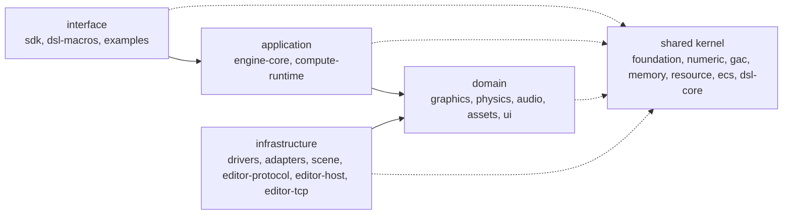

<div align="center">

<a id="top"></a>

# ⚙️ Meridian-Engine

**A modular Rust engine core for real-time graphics, audio and physics, built on one geometric-algebra spatial layer**

[](LICENSE)


🇺🇸 **English** | 🇷🇺 [Русский](README.ru.md)

[Overview](#-overview) · [Parts](#-parts) · [Getting Started](#-getting-started) · [Architecture](#-architecture) · [Development](#%EF%B8%8F-development) · [Status](#-status) · [License](#-license)

</div>

---

## 📖 Overview

Meridian-Engine is a small, stable set of crates in which math, memory,
resources, ECS, compute, drivers and domain cores each have one clear
responsibility. Rotations, transforms, physics angular quantities and the
audio listener all use the same geometric-algebra types (`Rotor`, `Motor3`)
instead of a separate matrix convention per subsystem, and a deterministic
`Fixed` (Q16.16) flavor sits beside the `f32` one.

It is not a monolithic engine: there are no global managers, no hub crate
that everything depends on, and domain crates never reach into drivers.
Applications depend on `meridian-sdk` alone; the other crates are its
building blocks.

## 🧩 Parts

The workspace has 28 crates plus the [`examples`](examples) package. The layer
and context of each are declared in [`craftbook.toml`](craftbook.toml); every
crate has its own README.

**Shared kernel**

| Crate | Context | What it gives |
|---|---|---|
| [`meridian-foundation`](crates/meridian-foundation) | diagnostics | Error conventions, log sink, crash reporting, CPU feature flags |
| [`meridian-numeric-core`](crates/meridian-numeric-core) | geometry | Scalar types, deterministic `Fixed`, numeric traits |
| [`meridian-gac-core`](crates/meridian-gac-core) | geometry | Geometric algebra: vectors, rotors, motors, shapes (float and `Fixed`) |
| [`meridian-memory-core`](crates/meridian-memory-core) | identity | Arenas, resource pools, generational handles |
| [`meridian-resource-core`](crates/meridian-resource-core) | identity | Typed resource ids, versions, dependency graph |
| [`meridian-ecs-core`](crates/meridian-ecs-core) | entity | Archetype ECS with SoA storage |
| [`meridian-dsl-core`](crates/meridian-dsl-core) | scene-markup | Domain-blind `.meui` markup parser and tag registry |

**Domain**

| Crate | Context | What it gives |
|---|---|---|
| [`meridian-graphics-core`](crates/meridian-graphics-core) | rendering | Render graph, scenes, culling, lighting, materials, camera, bloom |
| [`meridian-physics-core`](crates/meridian-physics-core) | physics | Rigid bodies, collision, solver, integrator, soft bodies |
| [`meridian-audio-core`](crates/meridian-audio-core) | audio | Spatial mixer, DSP graph, listener and emitters |
| [`meridian-asset-core`](crates/meridian-asset-core) | assets | Decoders for images, meshes, audio and shaders |
| [`meridian-ui-core`](crates/meridian-ui-core) | ui | WPF-style retained UI tree, layout, hit testing |

**Application**

| Crate | Context | What it gives |
|---|---|---|
| [`meridian-compute-runtime`](crates/meridian-compute-runtime) | compute | Compute context, kernel interfaces, dispatch size and split |
| [`meridian-engine-core`](crates/meridian-engine-core) | runtime | `Runtime`: frame scheduler, events, physics/audio subsystems, stages |

**Infrastructure (adapters)**

| Crate | Context | What it gives |
|---|---|---|
| [`meridian-task-core`](crates/meridian-task-core) | runtime | Job graph scheduler with worker threads |
| [`meridian-platform-core`](crates/meridian-platform-core) | platform | Window, input, clock, capabilities, dynamic libraries |
| [`meridian-gpu-driver`](crates/meridian-gpu-driver) | compute | Shared `wgpu` device, buffers, shaders, compute pipelines |
| [`meridian-compute-driver`](crates/meridian-compute-driver) | compute | CPU-SIMD and GPU compute dispatch |
| [`meridian-graphics-driver`](crates/meridian-graphics-driver) | rendering | Graphics device, surfaces, render pipelines |
| [`meridian-audio-driver`](crates/meridian-audio-driver) | audio | Audio output device via `cpal` |
| [`meridian-physics-driver`](crates/meridian-physics-driver) | physics | Physics execution backend report (to be deleted, ADR 019) |
| [`meridian-gac-compute`](crates/meridian-gac-compute) | geometry | Batch `Motor3` kernels on CPU-SIMD and GPU |
| [`meridian-physics-compute`](crates/meridian-physics-compute) | physics | Batched rigid-body and soft-body kernels |
| [`meridian-scene`](crates/meridian-scene) | data | `.mscene` documents on Substrate Data, `World` load/save |
| [`meridian-editor-protocol`](crates/meridian-editor-protocol) | editor | Typed game/editor messages as Substrate Data frames |
| [`meridian-editor-host`](crates/meridian-editor-host) | editor | The game's side of the protocol, without I/O: `Session`, `SimulationControl`, `RequestHandler` |
| [`meridian-editor-tcp`](crates/meridian-editor-tcp) | editor | Serves one editor over loopback TCP (the only editor crate with `tokio`) |
| [`meridian-mel-build`](crates/meridian-mel-build) | ui | `build.rs` generator turning `.meui` into typed Rust |

**Interface**

| Crate | Context | What it gives |
|---|---|---|
| [`meridian-dsl-macros`](crates/meridian-dsl-macros) | scene-markup | `#[dsl_tag]` attribute macro |
| [`meridian-sdk`](crates/meridian-sdk) | runtime | Single application entry point: re-exports, scene DSL, windowed-app scaffolding |

## 🚀 Getting Started

Requirements: Rust 1.92 or newer. On Linux the audio driver needs the ALSA
headers (`libasound2-dev`).

Depend on the crate you need. For example, the geometric algebra on its own:

```toml
[dependencies]
meridian-gac-core = { git = "https://github.com/F000NKKK/Meridian-Engine" }
```

```rust
use meridian_gac_core::{Rotor, Vec3};

fn main() {
    // Rotating X about Z by a quarter turn gives Y.
    let rotor = Rotor::from_axis_angle(Vec3::Z, std::f32::consts::FRAC_PI_2);
    let rotated = rotor.transform_vector(Vec3::X);
    assert!((rotated - Vec3::Y).length() < 1e-5);
}
```

To see the whole engine working, run an example. It opens a window, so it
needs a display and a GPU adapter:

```sh
./build.sh run magic_figures     # three orbiting, textured, glowing shapes with spatial audio
./build.sh run physic_figures    # the same shapes as rigid bodies falling onto a floor
```

Both examples build their scene from a `.meui` file under
[`examples/assets/scenes/`](examples/assets/scenes) and import everything through
`meridian_sdk`.

## 🏗️ Architecture

Dependencies point inwards: interface → application → domain ← infrastructure,
and every layer may use the shared kernel.



Domain and application crates own the port traits they need; driver crates
implement them. A few edges still point outwards and only shrink
(`./build.sh check-deps` lists them).

- [`docs/architecture.md`](docs/architecture.md): layering and the reasons behind it
- [`docs/dependency-rules.md`](docs/dependency-rules.md): which crate may depend on which
- [`docs/context-map.md`](docs/context-map.md), [`docs/glossary.md`](docs/glossary.md): bounded contexts and their words
- [`docs/roadmap.md`](docs/roadmap.md): current state and implementation order
- Subsystem design: [GAC](docs/gac-design.md), [ECS](docs/ecs-design.md), [graphics](docs/graphics-design.md), [physics](docs/physics-design.md), [memory](docs/memory-model.md), [threading](docs/threading-model.md)
- Decisions: [`docs/adr/`](docs/adr/), notably [ADR 019](docs/adr/019-ports-in-domain-drivers-as-adapters.md) (ports in the domain, drivers as adapters) and [ADR 020](docs/adr/020-craftbook-adoption.md) (Craftbook adoption)

## 🛠️ Development

Rust code follows [Craftbook](https://github.com/F000NKKK/craftbook); the
rules for agents and contributors are in [`CLAUDE.md`](CLAUDE.md) and
[`AGENTS.md`](AGENTS.md). The checks CI runs:

```sh
cargo fmt --all --check
python3 scripts/clippy_backlog.py           # clippy warnings may not exceed .clippy-backlog
./build.sh check-deps                       # crate graph matches docs/dependency-rules.md
python3 <craftbook>/tools/craftcheck check . --baseline .craftcheck-baseline
python3 <craftbook>/tools/craftcheck deps . --baseline .craftcheck-deps-baseline
cargo test --workspace
cargo test --workspace --doc
```

`./build.sh` also has `build`, `test`, `clippy`, `fmt`, `run <example>`,
`list-examples` and `clean`. Tests that need a real GPU or audio device are
behind the `hw-tests` feature (`cargo test --workspace --all-features`).
Crates are released with `./release.sh` (see its `--help`).

## 📊 Status

| Area | State |
|---|---|
| Geometric algebra, ECS, memory, resources, task graph | Implemented and tested |
| Windowing (`winit`), GPU rendering and compute (`wgpu`) | Implemented |
| Physics, spatial audio, assets, scene DSL | Implemented, in use by the examples |
| UI runtime (`ui-core`) | Layout and hit testing; rendering and input routing not done |
| Editor protocol, scene documents | Implemented; editor host (`Session` + loopback TCP) implemented, not yet wired into `engine-core`'s frame loop |
| Craftbook migration | In progress: some files and functions still above the limits, tracked by the baselines |

The plan is in [`docs/roadmap.md`](docs/roadmap.md).

## 📄 License

[MPL-2.0](LICENSE).

---

<div align="center">

[⬆ Back to Top](#top)

</div>
