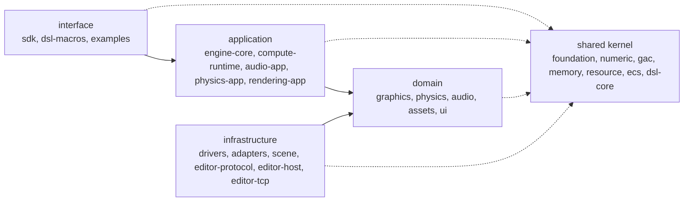

<div align="center">

<a id="top"></a>

# ⚙️ Meridian-Engine

**Модульное ядро игрового движка на Rust для графики, звука и физики реального времени на едином слое геометрической алгебры**

[](LICENSE)


🇺🇸 [English](README.md) | 🇷🇺 **Русский**

[Обзор](#-обзор) · [Состав](#-состав) · [Начало работы](#-начало-работы) · [Архитектура](#-архитектура) · [Разработка](#%EF%B8%8F-разработка) · [Состояние](#-состояние) · [Лицензия](#-лицензия)

</div>

---

## 📖 Обзор

Meridian-Engine — небольшой устойчивый набор крейтов, где математика, память,
ресурсы, ECS, вычисления, драйверы и доменные ядра отвечают каждый за одно.
Повороты, трансформации, угловые величины физики и слушатель звука используют
одни и те же типы геометрической алгебры (`Rotor`, `Motor3`), а не отдельную
матричную конвенцию в каждой подсистеме; рядом с `f32` есть детерминированный
вариант `Fixed` (Q16.16).

Это не монолитный движок: нет глобальных менеджеров, нет крейта-хаба, от
которого зависит всё, а доменные крейты не обращаются к драйверам. Приложения
зависят только от `meridian-sdk`; остальные крейты — его строительные блоки.

## 🧩 Состав

В рабочем пространстве 28 крейтов и пакет [`examples`](examples). Слой и
контекст каждого объявлены в [`craftbook.toml`](craftbook.toml); у каждого
крейта есть свой README.

**Общее ядро**

| Crate | Context | Что даёт |
|---|---|---|
| [`meridian-foundation`](crates/meridian-foundation) | diagnostics | Соглашения об ошибках, ядро журнала и порт `LogSink`, флаги возможностей CPU |
| [`meridian-diagnostics-fs`](crates/meridian-diagnostics-fs) | diagnostics | Файловый журнал и отчёты о падениях (адаптер) |
| [`meridian-numeric-core`](crates/meridian-numeric-core) | geometry | Скалярные типы, детерминированный `Fixed`, числовые трейты |
| [`meridian-gac-core`](crates/meridian-gac-core) | geometry | Геометрическая алгебра: векторы, роторы, моторы, фигуры (float и `Fixed`) |
| [`meridian-memory-core`](crates/meridian-memory-core) | identity | Арены, пулы ресурсов, поколенческие дескрипторы |
| [`meridian-resource-core`](crates/meridian-resource-core) | identity | Типизированные id ресурсов, версии, граф зависимостей |
| [`meridian-ecs-core`](crates/meridian-ecs-core) | entity | Архетипный ECS с хранением SoA |
| [`meridian-dsl-core`](crates/meridian-dsl-core) | scene-markup | Парсер разметки `.mel` без знания домена и реестр тегов |

**Домен**

| Crate | Context | Что даёт |
|---|---|---|
| [`meridian-graphics-core`](crates/meridian-graphics-core) | rendering | Граф рендера, сцены, отсечение, освещение, материалы, камера, bloom |
| [`meridian-physics-core`](crates/meridian-physics-core) | physics | Твёрдые тела, коллизии, решатель, интегратор, мягкие тела |
| [`meridian-audio-core`](crates/meridian-audio-core) | audio | Пространственный микшер, DSP-граф, слушатель и источники |
| [`meridian-asset-core`](crates/meridian-asset-core) | assets | Порт `Decoder`, CPU-типы ассетов и чистые парсеры BMP, WAV, OBJ и шейдеров |
| [`meridian-ui-core`](crates/meridian-ui-core) | ui | Удерживаемое дерево UI в стиле WPF, раскладка, hit-testing |

**Приложение**

| Crate | Context | Что даёт |
|---|---|---|
| [`meridian-compute-runtime`](crates/meridian-compute-runtime) | compute | Контекст вычислений, интерфейсы ядер, размер диспетчеризации и разделение |
| [`meridian-audio-app`](crates/meridian-audio-app) | audio | Порт `AudioSink` с фейком и контрактным набором тестов |
| [`meridian-physics-app`](crates/meridian-physics-app) | physics | `PhysicsSubsystem`, порт `PhysicsStepper` и `SequentialStepper` |
| [`meridian-rendering-app`](crates/meridian-rendering-app) | rendering | Порты `FrameRecorder`, `MeshStore`, `TextureStore` с фейками и контрактными наборами |
| [`meridian-engine-core`](crates/meridian-engine-core) | runtime | `Runtime`: стадии в порядке зависимостей, порт `JobExecutor`, события (состоянием не владеет) |

**Инфраструктура (адаптеры)**

| Crate | Context | Что даёт |
|---|---|---|
| [`meridian-task-core`](crates/meridian-task-core) | runtime | Планировщик графа задач с рабочими потоками |
| [`meridian-platform-core`](crates/meridian-platform-core) | platform | Окно, ввод, часы, возможности платформы, динамические библиотеки |
| [`meridian-gpu-driver`](crates/meridian-gpu-driver) | compute | Общее устройство `wgpu`, буферы, шейдеры, вычислительные конвейеры |
| [`meridian-compute-driver`](crates/meridian-compute-driver) | compute | Диспетчеризация вычислений на CPU-SIMD и GPU |
| [`meridian-graphics-driver`](crates/meridian-graphics-driver) | rendering | Графическое устройство, поверхности, конвейеры рендера |
| [`meridian-asset-png`](crates/meridian-asset-png) | assets | Адаптер-декодер PNG на крейте `png` |
| [`meridian-asset-symphonia`](crates/meridian-asset-symphonia) | assets | Адаптер-декодер MP3, OGG/Vorbis, FLAC, OGG/Opus и потокового звука |
| [`meridian-audio-driver`](crates/meridian-audio-driver) | audio | Устройство вывода звука через `cpal` |
| [`meridian-gac-compute`](crates/meridian-gac-compute) | geometry | Пакетные ядра `Motor3` на CPU-SIMD и GPU |
| [`meridian-physics-compute`](crates/meridian-physics-compute) | physics | Пакетные ядра твёрдых и мягких тел |
| [`meridian-scene`](crates/meridian-scene) | data | Документы `.mscene` на Substrate Data, загрузка и сохранение `World` |
| [`meridian-editor-protocol`](crates/meridian-editor-protocol) | editor | Типизированные сообщения игра/редактор в кадрах Substrate Data |
| [`meridian-editor-host`](crates/meridian-editor-host) | editor | Сторона игры в протоколе без ввода-вывода: `Session`, `SimulationControl`, `RequestHandler` |
| [`meridian-editor-tcp`](crates/meridian-editor-tcp) | editor | Обслуживает один редактор по loopback TCP (единственный crate редактора с `tokio`) |
| [`meridian-mel-build`](crates/meridian-mel-build) | ui | Генератор для `build.rs`: `.mel` в типизированный Rust |

**Интерфейс**

| Crate | Context | Что даёт |
|---|---|---|
| [`meridian-dsl-macros`](crates/meridian-dsl-macros) | scene-markup | Атрибутный макрос `#[dsl_tag]` |
| [`meridian-sdk`](crates/meridian-sdk) | runtime | Единая точка входа приложения: реэкспорты, DSL сцен, каркас оконного приложения |

## 🚀 Начало работы

Требуется Rust 1.92 или новее. В Linux драйверу звука нужны заголовки ALSA
(`libasound2-dev`).

Подключите нужный крейт. Например, только геометрическую алгебру:

```toml
[dependencies]
meridian-gac-core = { git = "https://github.com/F000NKKK/Meridian-Engine" }
```

```rust
use meridian_gac_core::{Rotor, Vec3};

fn main() {
    // Rotating X about Z by a quarter turn gives Y.
    let rotor = Rotor::from_axis_angle(Vec3::Z, std::f32::consts::FRAC_PI_2);
    let rotated = rotor.transform_vector(Vec3::X);
    assert!((rotated - Vec3::Y).length() < 1e-5);
}
```

Чтобы увидеть движок целиком, запустите пример. Он открывает окно, поэтому
нужны дисплей и GPU-адаптер:

```sh
./build.sh run magic_figures     # три вращающиеся текстурированные светящиеся фигуры с пространственным звуком
./build.sh run physic_figures    # те же фигуры как твёрдые тела, падающие на пол
```

Оба примера собирают сцену из файла `.mel` в
[`examples/assets/scenes/`](examples/assets/scenes) и импортируют всё через
`meridian_sdk`.

## 🏗️ Архитектура

Зависимости направлены внутрь: интерфейс → приложение → домен ← инфраструктура,
и любой слой может использовать общее ядро.



Доменные и прикладные крейты владеют нужными им трейтами-портами; драйверы их
реализуют. Несколько рёбер всё ещё направлены наружу и только сокращаются
(их перечисляет `./build.sh check-deps`).

- [`docs/architecture.md`](docs/architecture.md): слои и причины такого устройства
- [`docs/dependency-rules.md`](docs/dependency-rules.md): какой крейт от какого может зависеть
- [`docs/context-map.md`](docs/context-map.md), [`docs/glossary.md`](docs/glossary.md): ограниченные контексты и их словарь
- [`docs/roadmap.md`](docs/roadmap.md): текущее состояние и порядок реализации
- Дизайн подсистем: [GAC](docs/gac-design.md), [ECS](docs/ecs-design.md), [графика](docs/graphics-design.md), [физика](docs/physics-design.md), [память](docs/memory-model.md), [потоки](docs/threading-model.md)
- Решения: [`docs/adr/`](docs/adr/), в частности [ADR 019](docs/adr/019-ports-in-domain-drivers-as-adapters.md) (порты в домене, драйверы как адаптеры) и [ADR 020](docs/adr/020-craftbook-adoption.md) (принятие Craftbook)

## 🛠️ Разработка

Код на Rust следует [Craftbook](https://github.com/F000NKKK/craftbook); правила
для агентов и участников — в [`CLAUDE.md`](CLAUDE.md) и [`AGENTS.md`](AGENTS.md).
Проверки, которые запускает CI:

```sh
cargo fmt --all --check
python3 scripts/clippy_backlog.py           # предупреждений clippy не больше, чем в .clippy-backlog
./build.sh check-deps                       # граф крейтов совпадает с docs/dependency-rules.md
python3 <craftbook>/tools/craftcheck check . --baseline .craftcheck-baseline
python3 <craftbook>/tools/craftcheck deps . --baseline .craftcheck-deps-baseline
cargo test --workspace
cargo test --workspace --doc
```

В `./build.sh` есть также `build`, `test`, `clippy`, `fmt`, `run <пример>`,
`list-examples` и `clean`. Тесты, которым нужны настоящий GPU или аудиоустройство,
спрятаны за функцией `hw-tests` (`cargo test --workspace --all-features`).
Крейты выпускаются через `./release.sh` (см. его `--help`).

## 📊 Состояние

| Область | Состояние |
|---|---|
| Геометрическая алгебра, ECS, память, ресурсы, граф задач | Реализовано и протестировано |
| Окна (`winit`), GPU-рендер и вычисления (`wgpu`) | Реализовано |
| Физика, пространственный звук, ассеты, DSL сцен | Реализовано, используется примерами |
| UI-рантайм (`ui-core`) | Раскладка и hit-testing; отрисовка и маршрутизация ввода не готовы |
| Протокол редактора, документы сцен | Реализовано; хоста редактора пока нет |
| Миграция на Craftbook | В процессе: часть файлов и функций выше лимитов, учтена базовыми файлами |

План — в [`docs/roadmap.md`](docs/roadmap.md).

## 📄 Лицензия

[MPL-2.0](LICENSE).

---

<div align="center">

[⬆ Наверх](#top)

</div>
